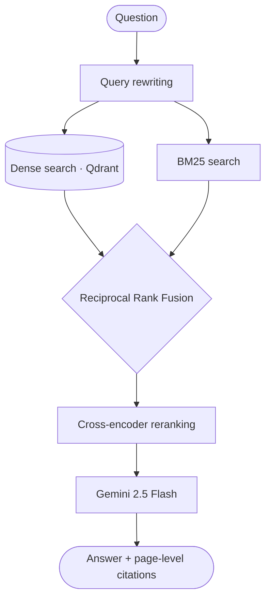
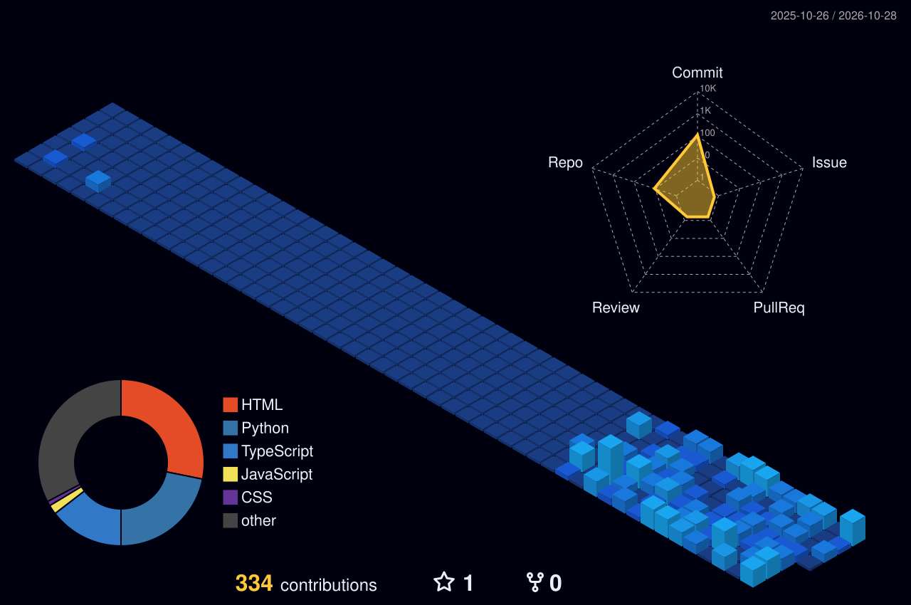

<div align="center">


<a href="https://git.io/typing-svg">
  
</a>

<br/><br/>


<br/><br/>


</div>

<br/>

<h1 align="center">🎯 Aspiring AI Engineer · Generative AI &amp; RAG Developer</h1>

<p align="center"><i>I build LLM applications that give grounded, citation-backed answers instead of guesses.</i></p>

<p align="center">
  
  
  
  
  
  
</p>

---

## 👋 About Me

I'm a third-year **B.Tech Computer Science (Data Science)** student at **ABES Engineering College** (AKTU), passionate about building intelligent, scalable, real-world AI applications. I like turning complex problems into practical, user-focused solutions by combining AI models with robust backend systems.

My main interests are **Generative AI, LLMs, Retrieval-Augmented Generation (RAG), Machine Learning and backend development**. I'm continuously exploring advanced AI architectures, agentic AI and production-oriented development while sharpening my problem-solving and software engineering skills.

```python
class Piyush:
    role      = "Python Developer | GenAI Application Developer"
    studying  = "B.Tech CSE (Data Science), ABES Engineering College, 2028"
    building  = ["Hybrid RAG systems", "LLM-powered apps", "FastAPI backends"]
    exploring = ["Agentic AI", "Advanced AI architectures", "Production-grade systems"]
    goal      = "Become an AI Engineer"
    seeking   = "Internships in AI Engineering, GenAI, ML and Python backend"
```

> [!TIP]
> **Open to internships and collaborations.** Reach me at [piyushpanigrahi21@gmail.com](mailto:piyushpanigrahi21@gmail.com) or on [LinkedIn](https://www.linkedin.com/in/piyushpanigrahi-sde).

---

## 🚀 Projects

### 📄 PaperChat: AI-Powered Research & Document Intelligence Assistant

> Chat with your documents and get answers you can verify, with page-level source citations.

| | |
|---|---|
| **What it does** | Document-based conversational Q&A with page-level citations, conversational memory and document summarization |
| **Retrieval** | 5-stage hybrid RAG: query rewriting → dense vector search → BM25 → Reciprocal Rank Fusion → cross-encoder reranking |
| **Backend** | PDF ingestion, conversational Q&A, JWT authentication and persistent chat management (4 core capabilities) |
| **Stack** | `Python` `FastAPI` `LangChain` `Gemini 2.5 Flash` `Qdrant` `PostgreSQL` `SQLAlchemy` `Docker` |



[](https://github.com/Piyush21-03)

### 🎓 CampusAI+: AI Student Support & Placement Predictor

> One platform for academic help, interview prep and career guidance, backed by a placement-prediction model.

| | |
|---|---|
| **What it does** | Flask-based AI platform with 2 modules: Gemini-powered student support and ML-based placement prediction |
| **Model** | 100-tree Random Forest classifier on 8 student-performance features, 80:20 train-test split, with probability scoring |
| **APIs** | REST endpoints for real-time predictions, placement status and personalized Gemini-generated career guidance |
| **Stack** | `Python` `Flask` `Gemini` `scikit-learn` |

[](https://github.com/Piyush21-03)
[](https://github.com/Piyush21-03)

<!-- TODO: replace the three links above with the exact repo URLs and the CampusAI+ live demo URL -->

---

## 💡 Areas of Expertise

<table align="center">
  <tr>
    <td align="center" width="25%"><h3>🧠</h3><b>Generative AI</b><br/><sub>LLM apps, prompt engineering, LLM API integration</sub></td>
    <td align="center" width="25%"><h3>🔎</h3><b>RAG Systems</b><br/><sub>Hybrid retrieval, BM25, RRF, cross-encoder reranking, citations</sub></td>
    <td align="center" width="25%"><h3>⚙️</h3><b>Backend Development</b><br/><sub>FastAPI, Flask, REST APIs, JWT auth, PostgreSQL</sub></td>
    <td align="center" width="25%"><h3>📈</h3><b>Machine Learning</b><br/><sub>scikit-learn, Pandas, NumPy, model training</sub></td>
  </tr>
</table>

---

## 🛠️ Top Tools & Technologies

**💻 Languages**


**🧠 AI / ML**


**⚙️ Backend & Databases**


**🧰 Tools**


---

## 📊 Top Languages

<p align="center">
  
  
</p>

---

## 🏆 Highlights & Experience

<table align="center">
  <tr>
    <td align="center" width="25%"><h3>💼</h3><b>Generative AI Intern</b><br/>IBM Virtual Internship<br/>Jun 2026 – Aug 2026</td>
    <td align="center" width="25%"><h3>🛡️</h3><b>Cybersecurity Intern</b><br/>IBM Virtual Internship<br/>Sep 2025 – Nov 2025</td>
    <td align="center" width="25%"><h3>🧩</h3><b>450+ DSA Problems</b><br/>100+ LeetCode<br/>350+ CodeChef</td>
    <td align="center" width="25%"><h3>🎓</h3><b>CGPA 7.7</b><br/>B.Tech CSE (Data Science)<br/>ABES Engineering College</td>
  </tr>
</table>

<details>
<summary><b>💼 IBM Generative AI Virtual Internship (Jun 2026 – Aug 2026)</b></summary>

<br/>

- Developed **Campus AI** with 5 AI-driven features and 4 core AI components to give context-aware responses to campus queries
- Integrated 2 LLM APIs and implemented 2 NLP/LLM workflows covering query processing, prompt handling and AI-generated responses
- Applied prompt engineering, NLP, LLM integration and API integration, taking a GenAI solution from concept to an application-ready implementation
- Completed IBM SkillsBuild's Generative AI program, covering LLM application design patterns and API-based integration workflows

</details>

<details>
<summary><b>🛡️ IBM Cybersecurity Virtual Internship (Sep 2025 – Nov 2025)</b></summary>

<br/>

- Completed 20+ hands-on cybersecurity labs through IBM SkillsBuild
- Covered network security, vulnerability assessment and secure software development practices
- Built a foundation in information security, digital threats and secure practices

</details>

---

## 🧮 DSA & Competitive Programming

<p align="center">
  
  
  
</p>

<p align="center">
  <!-- Replace YOUR_LEETCODE_USERNAME with your LeetCode username -->
  
</p>

---

## 🎓 Certifications

| Certification | Issuer |
|---|---|
| ☁️ AWS Cloud Architecting | AWS Academy |
| ☁️ AWS Cloud Foundations | AWS Academy |
| 🤖 IBM AI | IBM SkillsBuild |
| 🎯 Google AI Studio & Vibe Coding | Google |
| 📊 Exploratory Data Analysis | |
| 🐍 Python Development | |
| 🧪 GenAI Powered Data Analytics Job Simulation | |
| 🐍 Introduction to Programming Using Python | |

---

## 📈 GitHub Activity

<details open>
<summary>🔥 Streak & profile summary</summary>

<p align="center">
  
  
</p>

</details>

### 🌌 3D Contribution Graph

<p align="center">
  
</p>

<p align="center">
  
</p>

---

## 🌱 Roadmap

- 🔭 Going deeper on **advanced RAG** and retrieval quality
- 🤖 Exploring **agentic AI** and tool-using LLM workflows
- 🏗️ Building **production-oriented** systems with Docker, auth and persistence
- 💼 Looking for **internships** in AI Engineering, Generative AI, ML and Python backend
- 🧩 Keeping up consistent DSA practice

---

## 🔗 Connect With Me

<p align="center">
  <a href="https://www.linkedin.com/in/piyushpanigrahi-sde"></a>
  <a href="https://github.com/Piyush21-03"></a>
  <a href="mailto:piyushpanigrahi21@gmail.com"></a>
</p>

<p align="center"><sub>⭐ Thanks for stopping by. Explore my pinned repos or reach out through any link above.</sub></p>


