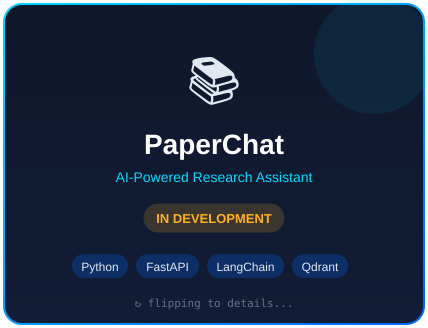
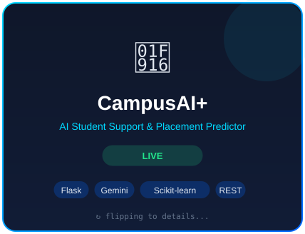
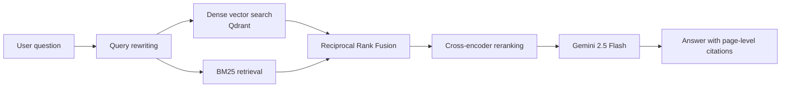
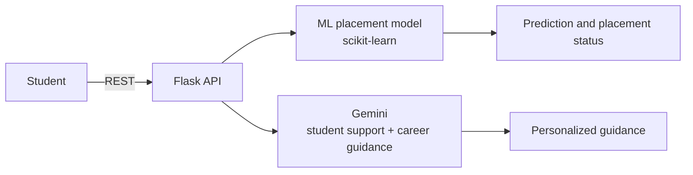
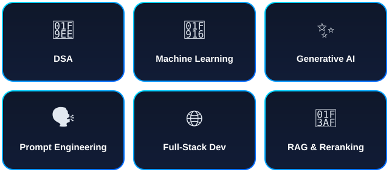

<!-- 1. Animated hero (self-hosted) -->

 

<!-- 2. Typing animation -->

 

<!-- 3. Status badges -->

  

<!-- 4. Animated terminal intro (self-hosted) -->

 

<h2 align="center">▰▰▰ <code>&nbsp;👋&nbsp;ABOUT&nbsp;</code> ▰▰▰</h2>

<i>Who I am and what I'm building</i>

  

> [!TIP]
> **Let's talk GenAI, RAG and Python:** reach me at [piyushpanigiri21@gmail.com](mailto:piyushpanigiri21@gmail.com) or on [LinkedIn](https://www.linkedin.com/in/piyush-panigrahi-64117a330).

 

<h2 align="center">▰▰▰ <code>&nbsp;🚀&nbsp;FEATURED PROJECTS&nbsp;</code> ▰▰▰</h2>

<i>Cards flip on their own: overview ↔ technical details</i>

<table align="center">
  <tr>
    <td align="center" valign="top">
      
    </td>
    <td align="center" valign="top">
      
    </td>
  </tr>
</table>

 

<!-- TODO: add your exact Live / Code links in the Links column -->

| Project | What it does | Stack | Links |
|---|---|---|---|
| **PaperChat** | AI research assistant for document-based conversational Q&A with page-level source citations, using a 5-stage hybrid RAG pipeline | Python, FastAPI, LangChain, Gemini 2.5 Flash, Qdrant | [Code](https://github.com/Piyush21-03?tab=repositories) |
| **CampusAI+** | Student support and ML-based placement prediction, with REST APIs and personalized Gemini-generated career guidance | Flask, Gemini, scikit-learn | [Code](https://github.com/Piyush21-03?tab=repositories) |

 

<h3 align="center"><code>&nbsp;🧩&nbsp;Architecture&nbsp;</code></h3>

<b>PaperChat</b> architecture

<b>CampusAI+</b> architecture

 

<h2 align="center">▰▰▰ <code>&nbsp;💡&nbsp;CORE FOCUS&nbsp;</code> ▰▰▰</h2>

<i>Front: the area · Back: the details</i>

  

 

<h2 align="center">▰▰▰ <code>&nbsp;🛠️&nbsp;TECH STACK&nbsp;</code> ▰▰▰</h2>

<i>Tools I build with</i>

<b>💻 Languages & Web</b>

<b>🧠 AI / Data</b>

<b>🧰 Tools & Deploy</b>

 

<h2 align="center">▰▰▰ <code>&nbsp;🏆&nbsp;HIGHLIGHTS&nbsp;</code> ▰▰▰</h2>

<i>Milestones so far</i>

<table align="center">
  <tr>
    <td align="center" width="33%">
      <h3>💼</h3>
      <b>GenAI Intern</b> 
      IBM Virtual Internship Jun 2026 – Aug 2026
    </td>
    <td align="center" width="33%">
      <h3>🛡️</h3>
      <b>Cybersecurity Intern</b> 
      IBM Virtual Internship Sep 2025 – Nov 2025
    </td>
    <td align="center" width="33%">
      <h3>🧩</h3>
      <b>450+ DSA Problems</b> 
      100+ LeetCode and 350+ CodeChef
    </td>
  </tr>
</table>

 

<h2 align="center">▰▰▰ <code>&nbsp;🎓&nbsp;CERTIFICATIONS&nbsp;</code> ▰▰▰</h2>

<i>Learning, verified</i>

<table align="center">
  <tr><td align="center">☁️ <b>AWS Cloud Architecting</b> — AWS Academy Graduate</td></tr>
  <tr><td align="center">☁️ <b>AWS Cloud Foundations</b> — AWS Academy Graduate</td></tr>
  <tr><td align="center">🤖 <b>IBM AI</b> — IBM SkillsBuild</td></tr>
  <tr><td align="center">🎯 <b>Google AI Studio & Vibe Coding</b></td></tr>
  <tr><td align="center">📊 <b>Exploratory Data Analysis</b></td></tr>
  <tr><td align="center">🐍 <b>Python Development</b></td></tr>
</table>

 

<h2 align="center">▰▰▰ <code>&nbsp;🎯&nbsp;CURRENT FOCUS&nbsp;</code> ▰▰▰</h2>

<i>What I'm going deeper on</i>

 

<h2 align="center">▰▰▰ <code>&nbsp;📊&nbsp;STATS DASHBOARD&nbsp;</code> ▰▰▰</h2>

<i>Numbers and activity</i>

  

📊 GitHub stats

  
  

  

 

<h2 align="center">▰▰▰ <code>&nbsp;⚡&nbsp;DAILY MOTIVATION&nbsp;</code> ▰▰▰</h2>

<table align="center" border="1" cellpadding="20">
  <tr>
    <td align="center">
      <!-- DAILY_QUOTE_START -->
 
<h3>💭 “Hardships often prepare ordinary people for an extraordinary destiny.”</h3>

<b>— C. S. Lewis</b>

 
<!-- DAILY_QUOTE_END -->
    </td>
  </tr>
</table>

 

<h2 align="center">▰▰▰ <code>&nbsp;🔗&nbsp;CONNECT&nbsp;</code> ▰▰▰</h2>

<i>Let's talk</i>

  
  
  
  

  ⭐️ Thanks for stopping by. Explore my pinned repos or drop a message via any link above.
   
  <a href="#about">↑ Back to top</a>

