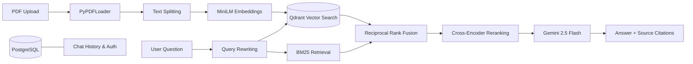
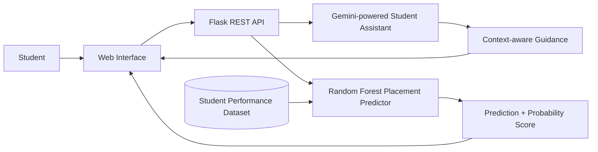

 

 

  

 

<h2 align="center">━━━ <code> 👋 ABOUT ME </code> ━━━</h2>

<i>Building practical AI applications with strong backend foundations</i>

  

> **Currently looking for:** internship and collaborative opportunities in Generative AI, AI Engineering, Machine Learning, and Python Backend Development.

  📄 <b>GitHub Profile Repo:</b> <a href="https://github.com/Piyush21-03/Piyush21-03">Open repository</a>
  &nbsp;•&nbsp;
  💼 <a href="https://www.linkedin.com/in/piyushpanigrahi-sde">LinkedIn</a>

 

<h2 align="center">━━━ <code> 🚀 FEATURED PROJECTS </code> ━━━</h2>

<i>Projects focused on AI, retrieval, and real-world problem solving</i>

| Project | What it does | Tech stack | Links |
|---|---|---|---|
| **PaperChat** | AI-powered research assistant for PDF-based Q&A, source citations, conversational memory, and document understanding. Uses a 5-stage hybrid RAG pipeline with query rewriting, dense retrieval, BM25, Reciprocal Rank Fusion, and cross-encoder reranking. | Python, FastAPI, LangChain, Gemini 2.5 Flash, Qdrant, PostgreSQL, SQLAlchemy, Docker | [Code](https://github.com/Piyush21-03/Paperchat) |
| **CampusAI+** | AI student-support platform combining a Gemini-powered assistant with an ML-based placement predictor and personalized career guidance. | Python, Flask, Gemini API, scikit-learn, Random Forest, Pandas | [Live demo](https://campus-ai-project.onrender.com) |
| **AQI Prediction & Hotspot Analysis** | Academic project exploring air-quality data processing, prediction, and hotspot analysis using data-driven methods. | Python, Pandas, NumPy, scikit-learn, APIs / sensor-data concepts | [GitHub repositories](https://github.com/Piyush21-03?tab=repositories) |

 

<h3 align="center"><code> 🧩 Architecture </code></h3>

<b>PaperChat — Hybrid RAG pipeline</b>

<b>CampusAI+ — Student support and placement prediction</b>

 

<h2 align="center">━━━ <code> 🛠️ TECH STACK </code> ━━━</h2>

<i>Tools and technologies I work with</i>

<b>💻 Languages & Web</b>

  
  
  
  
  
  
  

<b>🧠 AI, ML & Backend</b>

  
  
  
  
  
  
  
  
  

<b>🗄️ Databases, Tools & Deployment</b>

  
  
  
  
  
  
  
  

 

<h2 align="center">━━━ <code> 🏆 EXPERIENCE & HIGHLIGHTS </code> ━━━</h2>

<table align="center">
  <tr>
    <td align="center" width="50%">
      <h3>🤖</h3>
      <b>Generative AI Virtual Internship</b> 
      IBM SkillsBuild 
      June 2026 – August 2026
    </td>
    <td align="center" width="50%">
      <h3>🛡️</h3>
      <b>Cybersecurity Virtual Internship</b> 
      IBM SkillsBuild 
      September 2025 – November 2025
    </td>
  </tr>
  <tr>
    <td align="center" width="50%">
      <h3>💻</h3>
      <b>100+ LeetCode Problems</b> 
      Problem-solving practice
    </td>
    <td align="center" width="50%">
      <h3>⚡</h3>
      <b>350+ CodeChef Problems</b> 
      Competitive programming practice
    </td>
  </tr>
</table>

 

<h2 align="center">━━━ <code> 🎯 CURRENT FOCUS </code> ━━━</h2>

  
  
  
  
  

 

<h2 align="center">━━━ <code> 📊 STATS DASHBOARD </code> ━━━</h2>

<i>GitHub activity and coding practice</i>

  
  

  

<!-- 3D contribution graph: generated daily by the GitHub Actions workflow in .github/workflows/profile-3d.yml -->

  

  

 

<h2 align="center">━━━ <code> 🔗 CONNECT </code> ━━━</h2>

<i>Always happy to learn, build, and collaborate</i>

  
  
  

  ⭐ Thanks for visiting! Explore my repositories and feel free to connect. 
  <a href="#about">↑ Back to top</a>

